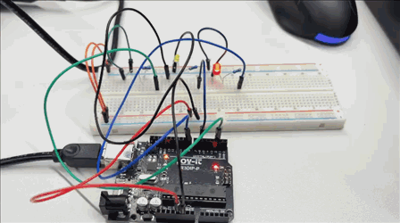
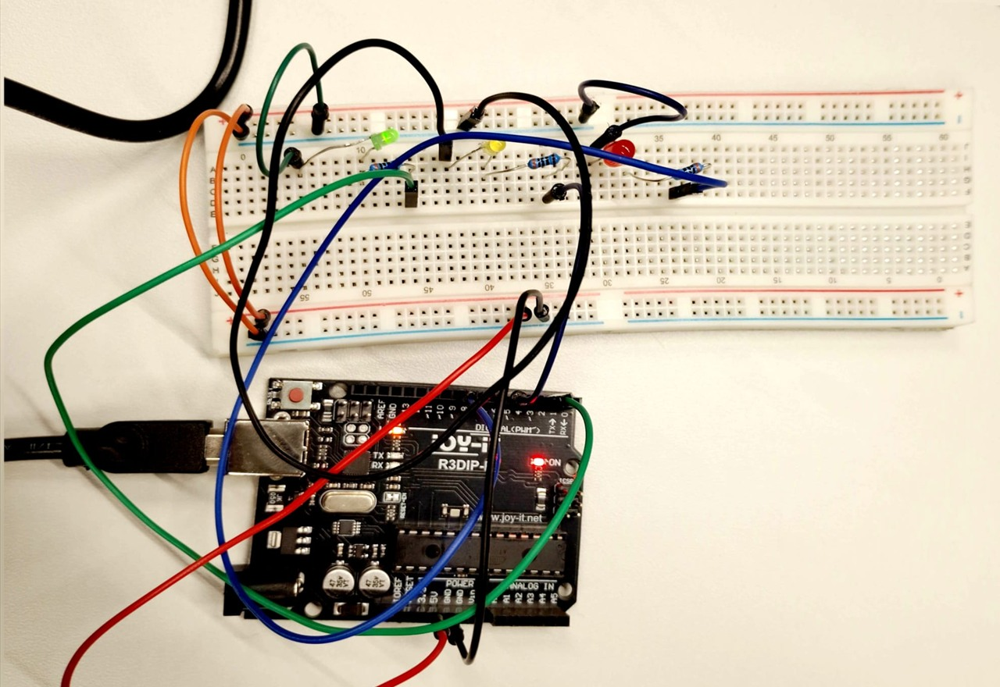
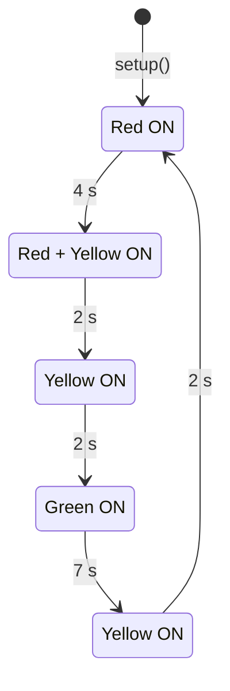
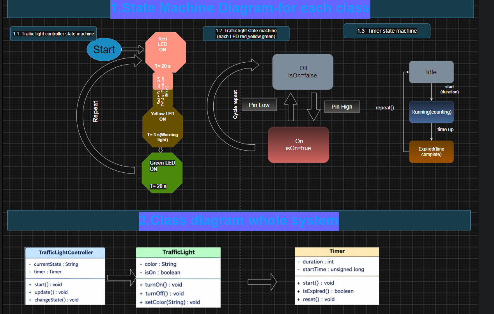

# Arduino Hardware Implementation — Traffic Light System (Task 3)

[](https://www.arduino.cc/)
[](https://isocpp.org/)
[](https://shorturl.at/akzd5)

Real-hardware implementation of the **Task 1 Traffic Light System** built and tested in the Embedded Systems Lab on an **Arduino Uno (Joy-IT R3DIP / ATmega328P)**. This folder demonstrates how the realized state machine diagram, class diagram, and Tinkercad simulation map directly onto the physical target hardware.

---

## 🎥 Live Hardware Demonstration (00:00–00:18, Silent)

Complete 17-second traffic light cycle (`Red` → `Red + Yellow` → `Yellow` → `Green` → `Yellow` → `Red`) running on the physical Arduino board:

<p align="center">
  <a href="https://raw.githubusercontent.com/Sohan331/RS2_Embreadded/main/Arduino-Hardware-Implementation-Project_1/demo.mp4">
    
  </a>
</p>

<p align="center">
  <a href="https://raw.githubusercontent.com/Sohan331/RS2_Embreadded/main/Arduino-Hardware-Implementation-Project_1/demo.mp4">
    
  </a>
</p>

---

## 🛠️ Real Lab Breadboard Circuit

<p align="center">
  
</p>

---

## 🔌 Pin Mapping & Signal Timing

### Hardware Pinout

| Arduino Pin | Variable | Component | Mode | Notes |
| :--- | :---: | :--- | :---: | :--- |
| **Pin 8** | `red` | Red LED | `OUTPUT` | Connected via 220 Ω resistor |
| **Pin 6** | `yellow` | Yellow LED | `OUTPUT` | Connected via 220 Ω resistor |
| **Pin 2** | `green` | Green LED | `OUTPUT` | Connected via 220 Ω resistor |
| **GND** | — | Common Ground | — | Breadboard negative rail |

### Implemented Cycle Sequence (17 s Total)

| Step | Phase | Active LED(s) | Duration |
| :---: | :--- | :--- | :---: |
| **1** | Stop | Red | `4 s` |
| **2** | Prepare | Red + Yellow | `2 s` |
| **3** | Transition | Yellow | `2 s` |
| **4** | Go | Green | `7 s` |
| **5** | Caution | Yellow | `2 s` |

---

## 🔄 Mapping Task 1 (Diagrams & Simulation) to Real Hardware

| Task 1 Artifact | Real Target System Mapping (Lab Arduino) |
| :--- | :--- |
| **Tinkercad Simulation** ([View Circuit](https://shorturl.at/akzd5)) | Directly replicated on the physical breadboard using identical digital pins (`8`, `6`, `2`), 220 Ω current-limiting resistors, and common ground return. |
| **State Machine Diagram** (`docs/system_diagram.png`) | Each diagram state (`Red`, `Red + Yellow`, `Yellow`, `Green`) maps directly to a sequential state block in `loop()`, including the return `Yellow` warning transition before `Red`. Phase durations were adjusted (`4 s / 2 s / 2 s / 7 s / 2 s`) for practical lab observation. |
| **Class Diagram** (`TrafficLightController`, `TrafficLight`, `Timer`) | Mapped to lightweight native Arduino primitives on the ATmega328P: `setup()`/`loop()` handles controller sequencing (`TrafficLightController`), `pinMode()`/`digitalWrite()` controls each LED pin (`TrafficLight`), and `delay()` enforces deterministic phase intervals (`Timer`). |

### Realized State Sequence (Versionable Mermaid Model)



### Task 1 System Diagrams (State Machine & Class Diagram)

- **Editable Source (Versionable XML):** [`docs/EmbeddedPractical.drawio`](docs/EmbeddedPractical.drawio)

<p align="center">
  
</p>

---

## 📁 Project Structure & File Formats

Version-friendly text/XML formats (`.ino`, `.md`, Mermaid, `.drawio`) are organized alongside hardware verification media:

```text
Arduino-Hardware-Implementation-Project_1/
├── README.md                                  # Documentation & Mermaid state diagram
├── demo.mp4                                   # 18-second silent hardware demo video (full quality)
├── docs/
│   ├── EmbeddedPractical.drawio               # Versionable Draw.io diagram source (XML)
│   ├── system_diagram.png                     # State machine & class diagram overview
│   ├── hardware_circuit.jpg                   # Horizontal lab breadboard wiring photo
│   └── demo_preview.gif                       # Inline auto-playing preview for GitHub
└── src/
    └── traffic_light_controller/
        └── traffic_light_controller.ino       # Target Arduino Uno firmware sketch
```

---

## 💻 Uploading to the Arduino

1. Connect the **Arduino Uno** to your PC via USB.
2. Open [`src/traffic_light_controller/traffic_light_controller.ino`](src/traffic_light_controller/traffic_light_controller.ino) in the Arduino IDE.
3. Select **Arduino Uno** under **Tools > Board**, choose your **Port**, and click **Upload**.
