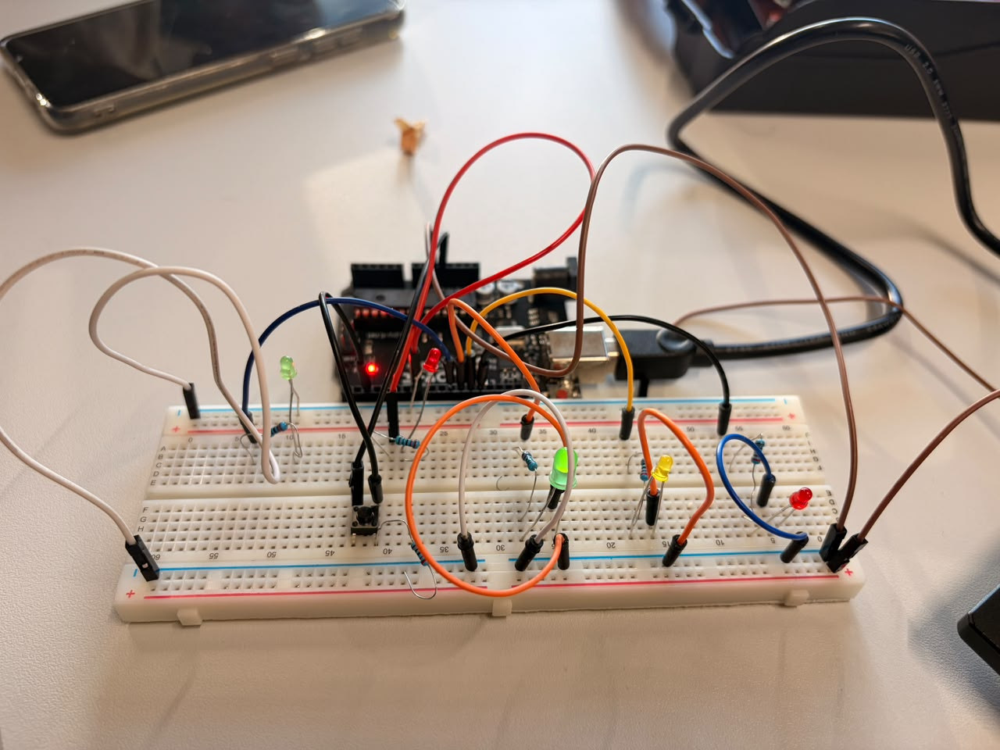
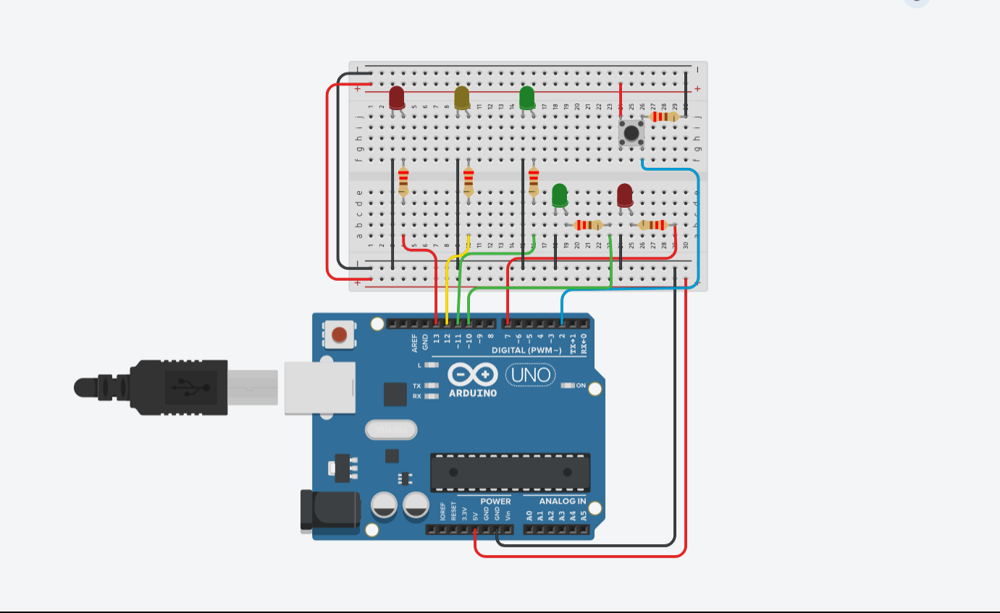
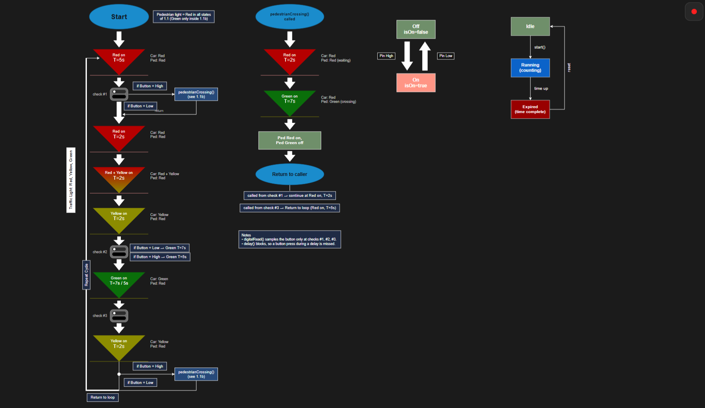
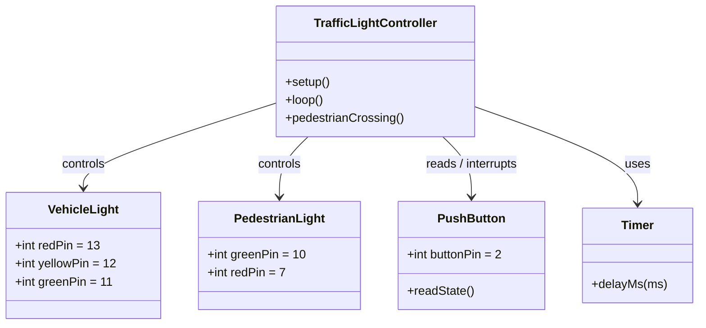

# Arduino Hardware Implementation — Smart Traffic Light System (Task 4)

Real-hardware implementation of **Task 2 (Traffic Light System with Pedestrian Crossing)** built and tested in the lab on an **Arduino Uno (ATmega328P)**.

---

## 🎥 Hardware Demo & Circuit

- **Hardware Demo Video (1080p HD, Silent):** [`Demo.mp4`](./Demo.mp4)
- **Task 2 Tinkercad Simulation:** [Open Tinkercad Circuit](https://www.tinkercad.com/things/lw6mdx8b40G-copy-of-pr2-update-traffic-light-system?sharecode=GDI3W6okflb5UjewmtQqD8fbNvfhd8kKurzvTqLfaIY)

### Real Lab Breadboard Setup
<p align="center">
  
</p>

### Task 2 Tinkercad Reference Circuit
<p align="center">
  
</p>

---

## 🔌 Pin Mapping

Both the simulation and the real Arduino hardware share the exact same pin assignment:

| Component | Arduino Pin | Variable | Mode |
| :--- | :---: | :---: | :---: |
| **Vehicle Red LED** | `Pin 13` | `red` | `OUTPUT` |
| **Vehicle Yellow LED** | `Pin 12` | `yellow` | `OUTPUT` |
| **Vehicle Green LED** | `Pin 11` | `green` | `OUTPUT` |
| **Pedestrian Green LED** | `Pin 10` | `pl_green` | `OUTPUT` |
| **Pedestrian Red LED** | `Pin 7` | `pl_red` | `OUTPUT` |
| **Pedestrian Pushbutton** | `Pin 2` | `pl_button` | `INPUT` |

---

## 🔄 Mapping Task 2 (Diagrams & Simulation) to Real Hardware

| Task 2 Artifact | Target Hardware Realization (Arduino Uno) |
| :--- | :--- |
| **Tinkercad Simulation** (`docs/tinkercad_circuit.png`) | Wired identically on the lab breadboard (`Pins 13, 12, 11, 10, 7, 2`) with 220 Ω LED resistors and a pull-down resistor on the button. |
| **State Machine Diagram** (`docs/system_diagram.png`) | Each state (`Red 5 s` → `Red+Yellow` → `Yellow` → `Green` → `Yellow`) maps directly to `loop()`, and the pedestrian sub-state machine (`2 s` wait + `7 s` walk) maps to `pedestrianCrossing()`. |
| **Class Diagram** (Mermaid model below) | Mapped to lightweight Arduino C++ primitives: `setup()`/`loop()`/`pedestrianCrossing()` act as the controller, `digitalWrite()` drives the LEDs, `digitalRead()`/`attachInterrupt()` reads the button, and `delay()` manages phase timing. |

### State Machine Diagram
- **Versionable Source (XML):** [`docs/traffic_light_diagram.drawio`](docs/traffic_light_diagram.drawio)

<p align="center">
  
</p>

### Class Diagram Mapping (Versionable Mermaid)



---

## 🔘 Button Input: Polling vs. Interrupt Implementation

To demonstrate the two ways of retrieving button presses on the same hardware (`Pin 2` / `INT0`), two sketches are provided in `src/`:

1. **Polling Implementation (Main Project Code):** [`src/traffic_light_controller/traffic_light_controller.ino`](src/traffic_light_controller/traffic_light_controller.ino)
2. **Interrupt Implementation:** [`src/traffic_light_interrupt/traffic_light_interrupt.ino`](src/traffic_light_interrupt/traffic_light_interrupt.ino)

| Aspect | Polling (`traffic_light_controller.ino`) | Hardware Interrupt (`traffic_light_interrupt.ino`) |
| :--- | :--- | :--- |
| **Mechanism** | Calls `digitalRead(pl_button)` at fixed checkpoints in `loop()`. | Uses `attachInterrupt(digitalPinToInterrupt(2), handleButtonPress, RISING)`. |
| **During `delay()`** | CPU is blocked; short button presses during `delay()` are **missed**. | Hardware interrupt `INT0` fires immediately even during `delay()` and latches `volatile bool button_pressed = true`. |
| **User Experience** | Pedestrian must hold the button until a checkpoint is reached. | A single brief button tap at any moment is reliably recorded and served at the next safe phase. |
| **Complexity** | Very simple sequential code. | Requires a hardware interrupt pin (`Pin 2` or `Pin 3` on Uno) and a `volatile` flag. |

---

## 📁 Project Structure

Versionable text/XML formats (`.ino`, `.md`, `.drawio`) are organized in a clean folder hierarchy:

```text
Arduino-Hardware-Implementation-Project_2/
├── README.md                                  # Project documentation & Mermaid class diagram
├── Demo.mp4                                   # Muted 1080p hardware demonstration video
├── docs/
│   ├── hardware_circuit.jpg                   # Lab Arduino & breadboard photo
│   ├── tinkercad_circuit.png                  # Task 2 Tinkercad schematic
│   ├── system_diagram.png                     # State machine diagram overview
│   └── traffic_light_diagram.drawio           # Versionable Draw.io XML source
└── src/
    ├── traffic_light_controller/
    │   └── traffic_light_controller.ino       # Polling-based implementation (Task 2 code)
    └── traffic_light_interrupt/
        └── traffic_light_interrupt.ino        # Interrupt-based implementation (INT0 on Pin 2)
```
