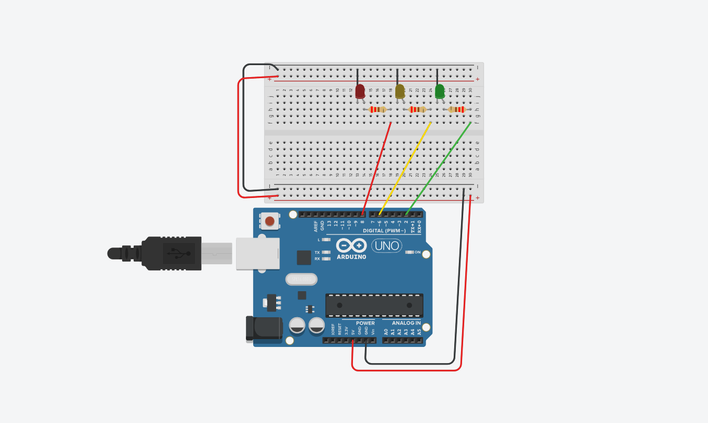
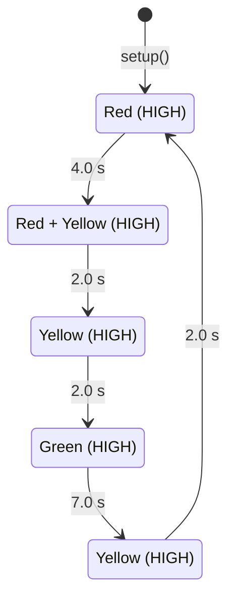
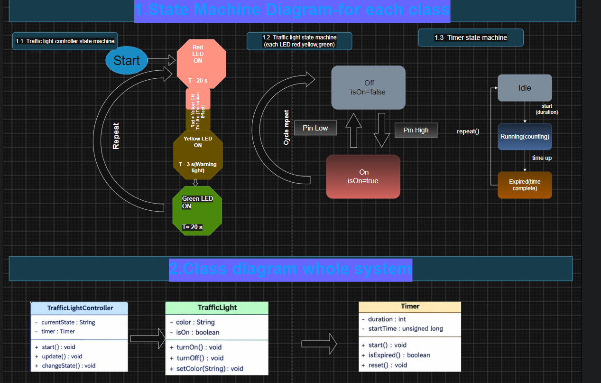

# Arduino Traffic Light Controller

[](https://www.arduino.cc/)
[](https://isocpp.org/)
[](https://shorturl.at/akzd5)
[](LICENSE)

An embedded traffic control system developed for the **Arduino Uno (ATmega328P)**. The project models an automated junction signal cycling sequentially through Red, Red + Yellow, Yellow, and Green phases.

---

## Table of Contents

- [Overview](#overview)
- [Cycle Timing & Signal Sequence](#cycle-timing--signal-sequence)
- [Hardware & Circuit Design](#hardware--circuit-design)
  - [Pin Mapping](#pin-mapping)
  - [Electrical Specifications & Resistor Sizing](#electrical-specifications--resistor-sizing)
  - [Circuit Diagram](#circuit-diagram)
- [System Architecture & State Sequence](#system-architecture--state-sequence)
  - [State Transition Model](#state-transition-model)
  - [System Architecture Diagram](#system-architecture-diagram)
- [Simulation & CAD Assets](#simulation--cad-assets)
- [Getting Started](#getting-started)
- [License](#license)

---

## Overview

Road traffic controllers require deterministic timing and clear light transitions. This project realizes a 5-step traffic cycle totaling **17.0 seconds**:

1. **Red** (Stop): 4.0 s
2. **Red + Yellow** (Pre-green preparation): 2.0 s
3. **Yellow** (Transition): 2.0 s
4. **Green** (Proceed): 7.0 s
5. **Yellow** (Caution before stop): 2.0 s

Both the hardware schematic and control sequence were validated in Autodesk Tinkercad.

---

## Cycle Timing & Signal Sequence

| Step | Signal Phase | Active LEDs | Duration | Purpose / Vehicle Meaning |
|:---:|:---|:---:|:---:|:---|
| **1** | `Red` | **Red** | `4.0 s` | Traffic stop / cross-traffic clearance |
| **2** | `Red + Yellow` | **Red + Yellow** | `2.0 s` | Driver preparation |
| **3** | `Yellow` | **Yellow** | `2.0 s` | Pre-green transition |
| **4** | `Green` | **Green** | `7.0 s` | Right-of-way granted / traffic flow |
| **5** | `Yellow` | **Yellow** | `2.0 s` | Caution / warning before returning to Red |

$$\text{Total Cycle Duration} = 4.0\,\text{s} + 2.0\,\text{s} + 2.0\,\text{s} + 7.0\,\text{s} + 2.0\,\text{s} = \mathbf{17.0\,\text{s}}$$

---

## Hardware & Circuit Design

### Pin Mapping

| Arduino Pin | Variable Name | Component | Direction | Current Limiter | Description |
|---|---|---|---|---|---|
| **Digital Pin 8** | `red` | Red 5 mm LED | `OUTPUT` | $220\,\Omega$ | Red stop indicator |
| **Digital Pin 6** | `yellow` | Yellow 5 mm LED | `OUTPUT` | $220\,\Omega$ | Yellow caution indicator |
| **Digital Pin 2** | `green` | Green 5 mm LED | `OUTPUT` | $220\,\Omega$ | Green proceed indicator |
| **GND** | — | Breadboard bus | — | — | Common cathode return |

### Electrical Specifications & Resistor Sizing

The Arduino Uno supplies $V_{CC} = 5.0\,\text{V}$ from its ATmega328P I/O pins (max $40\,\text{mA}$ per pin absolute maximum, recommended $\le 20\,\text{mA}$). Standard current-limiting resistors were calculated using Ohm's Law:

$$R = \frac{V_{CC} - V_F}{I_F}$$

* Forward Voltage ($V_F$): $\approx 2.0\,\text{V}$
* Target Forward Current ($I_F$): $\approx 13.6\,\text{mA}$
* Ideal Resistance: $R = \frac{5.0 - 2.0}{0.0136} \approx 220\,\Omega$

Standard $220\,\Omega \pm 5\%$ (Red-Red-Brown-Gold) through-hole resistors protect each LED diode from overcurrent.

### Circuit Diagram



> Interactive Tinkercad Circuit: [View Simulation](https://shorturl.at/akzd5)

---

## System Architecture & State Sequence

### State Transition Model



### System Architecture Diagram



* Full-resolution drawing: [Google Drive Link](https://drive.google.com/file/d/1RoIWKrtxsQdbZA15A9k0wHQC-ORTJWj-/view)
* Draw.io Editable Source: [`docs/EmbeddedPractical.drawio`](https://drive.google.com/file/d/1RoIWKrtxsQdbZA15A9k0wHQC-ORTJWj-/view?usp=sharing)

---

## Simulation & CAD Assets

* **Tinkercad Simulation**: [https://shorturl.at/akzd5](https://shorturl.at/akzd5)
* **High-Resolution Diagram (Drive)**: [Full Size System Diagram](https://drive.google.com/file/d/1RoIWKrtxsQdbZA15A9k0wHQC-ORTJWj-/view)
* **Draw.io Schematic Source**: [`docs/EmbeddedPractical.drawio`](docs/EmbeddedPractical.drawio)

---

## Getting Started

### Hardware Requirements

* 1 × Arduino Uno R3 (or compatible ATmega328P board)
* 1 × Breadboard & jumper wires
* 1 × Red 5 mm LED
* 1 × Yellow 5 mm LED
* 1 × Green 5 mm LED
* 3 × $220\,\Omega$ Resistors ($\frac{1}{4}\,\text{W}$)
* 1 × USB Type-A to Type-B cable

### Flashing via Arduino IDE

1. Clone this repository:
   ```bash
   git clone https://github.com/Sohan331/RS2_Embreadded.git
   ```
2. Open the sketch: [`src/traffic_light_controller/traffic_light_controller.ino`](src/traffic_light_controller/traffic_light_controller.ino).
3. Under **Tools > Board**, select **Arduino Uno**.
4. Under **Tools > Port**, select your board's COM port.
5. Click **Upload** ($\rightarrow$).

---

## License

This project is released under the [MIT License](LICENSE).
