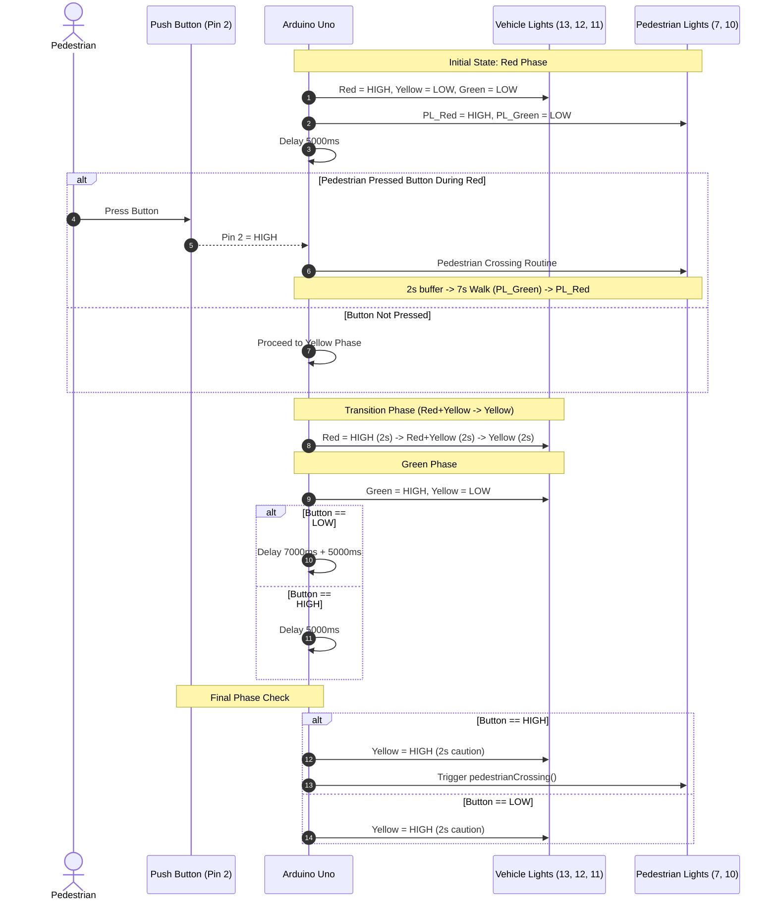

# Smart Traffic Light System with Pedestrian Crossing

An interactive, priority-based traffic light controller developed for the **Arduino Uno (ATmega328P)**. This system manages vehicular traffic while integrating an on-demand pedestrian crossing request via a digital pushbutton.

---

## 📌 Features

- **Automated Vehicular Cycle:** Cycles between Red, Yellow, and Green lights with clear transition warnings.
- **On-Demand Pedestrian Crossing:** A push button on Pin 2 triggers safe pedestrian walk cycles.
- **Safety Buffers:** Incorporates transition delays to ensure vehicles come to a complete stop before pedestrian signals turn green.

---

## 🔌 Hardware & Pin Configuration

| Component | Pin | Mode | Purpose |
| :--- | :---: | :---: | :--- |
| **Vehicle Red LED** | `Pin 13` | `OUTPUT` | Stops vehicular traffic |
| **Vehicle Yellow LED** | `Pin 12` | `OUTPUT` | Caution / transition phase |
| **Vehicle Green LED** | `Pin 11` | `OUTPUT` | Vehicle right-of-way |
| **Pedestrian Green LED** | `Pin 10` | `OUTPUT` | Safe crossing indicator |
| **Pedestrian Red LED** | `Pin 7` | `OUTPUT` | Pedestrian stop / wait indicator |
| **Pedestrian Pushbutton** | `Pin 2` | `INPUT` | Pedestrian crossing request input |

---

## 🔄 Sequence Diagram

The sequence diagram below illustrates the operational flow of the system, including normal cycling and the pedestrian interrupt routine:

---

## ⏱️ Operation & Timing Logic

1. **Vehicle Red Phase (5s):**
   - Vehicle Red is active, Pedestrian Red is active.
   - The button is polled at the end of 5 seconds. If pressed (`HIGH`), the pedestrian crossing routine is executed immediately.

2. **Transition Phase (6s total):**
   - Vehicle Red is held for 2s, Red + Yellow is held for 2s, and Yellow alone is held for 2s to prepare drivers.

3. **Vehicle Green Phase:**
   - Gives right-of-way to vehicles.
   - Duration adapts dynamically based on button input.

4. **Pedestrian Crossing Routine (`pedestrianCrossing()`):**
   - **Vehicle Halt:** Vehicle lights set immediately to Red.
   - **Safety Delay (2s):** Pedestrian Red remains active for 2s while vehicles come to a complete halt.
   - **Walk Signal (7s):** Pedestrian Green turns active for 7 seconds.
   - **Clearance:** Pedestrian Green turns off, and Pedestrian Red is restored.

---

## 📐 Schematics & System Diagrams

### Circuit Schematic
Interactive Tinkercad Model: [Tinkercad Simulation](https://www.tinkercad.com/things/lw6mdx8b40G-copy-of-pr2-update-traffic-light-system?sharecode=GDI3W6okflb5UjewmtQqD8fbNvfhd8kKurzvTqLfaIY)

### System Block Diagram
Editable Draw.io Diagram: [Google Drive Draw.io File](https://drive.google.com/file/d/1IKe1vXCG48pYgHF-5uRdoNBxFWU_hF1x/view?usp=sharing)

---

## 💻 Source Code

The firmware is located in [`traffic_light_controller.ino`](./traffic_light_controller.ino).

To upload to your board:
1. Connect your **Arduino Uno** via USB.
2. Open [`traffic_light_controller.ino`](./traffic_light_controller.ino) in the Arduino IDE.
3. Select board `Arduino Uno` and the corresponding COM port.
4. Click **Upload**.
